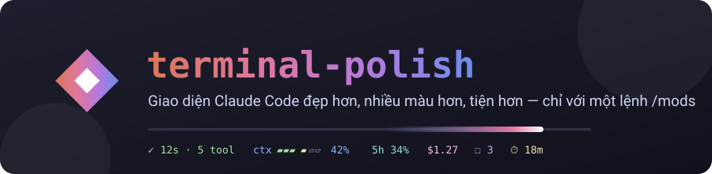
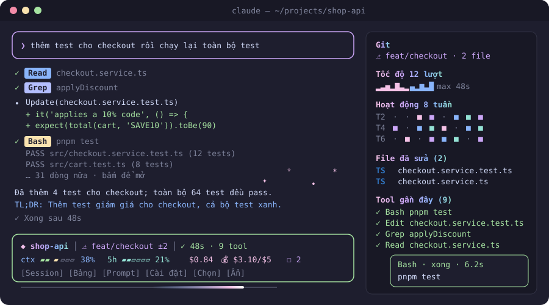

<div align="center">



[](https://github.com/thangvofastboy/claude-mods/tags)


**Một lệnh `/mods`, cả chục thứ tiện lợi.**<br/>
Dải trạng thái sống động · bảng điều khiển · 6 theme màu · chặn lệnh nguy hiểm · hoàn tác · ngân sách · TODO · và nhiều hơn nữa.

[🚀 Cài đặt](#-cài-đặt) ·
[✨ Tính năng](#-tính-năng) ·
[⌨️ Lệnh](#️-bảng-lệnh-mods) ·
[🎨 Theme](#-theme) ·
[⚙️ Cài đặt](#️-tab-cài-đặt) ·
[🔄 Cập nhật](#-cập-nhật--phát-hành) ·
[🛠️ Phát triển](#️-phát-triển) ·
[❓ FAQ](#-faq)



</div>

---

## 🚀 Cài đặt

Gõ trong Claude Code:

```text
/plugin marketplace add thangvofastboy/claude-mods
/plugin install terminal-polish@claude-mods
```

Rồi gõ **`/mods`** để xem toàn bộ lệnh, hoặc **`/mods settings`** để bật/tắt từng tính năng bằng một cú bấm.

> [!TIP]
> Mở terminal rộng từ **110 cột** trở lên ở chế độ fullscreen để các bảng nằm thành sidebar cạnh hội thoại. Terminal hẹp hơn thì bảng hiện ngay trên ô prompt.

---

## ✨ Tính năng

### 🖥️ Giao diện

| | Tính năng | Mô tả |
| :-: | --- | --- |
| 📟 | **Dải trạng thái** | `◆ dự-án ⎇ main ±3 │ ✓ 12s · 5 tool │ ctx ▰▰▰▱▱▱ 42% │ 5h 34% │ $0.31` ngay trên ô prompt, kèm các nút **Session · Bảng · Prompt · Cài đặt · Chọn · Ẩn**. |
| 🟢 | **Viền theo trạng thái** | Xanh khi rảnh, vàng khi đang chạy, đỏ khi lượt trước có lỗi. |
| 🌈 | **Chữ chuyển màu** | Tên dự án, tiêu đề panel và logo được tô chuyển màu theo theme. |
| ▰ | **Thanh đo màu** | Context, quota và ngân sách hiện dạng `▰▰▰▱▱▱`, chuyển dần từ xanh sang vàng rồi đỏ. |
| ✨ | **Hiệu ứng** | Vệt sáng chạy ngang khi Claude đang làm; pháo hoa 🎉 khi test pass hoặc xong một việc dài không lỗi. |
| 👋 | **Màn chào** | Logo, lời chào theo giờ, số liệu lần làm việc trước và một mẹo dùng; tự ẩn khi bạn gửi prompt đầu tiên. |
| 🏷️ | **Badge tool** | Dòng Bash, Read, Grep, Glob, Agent, Web và MCP có nhãn màu kèm ✓ / ✗ / ◌. Edit và Write giữ cách hiển thị gốc để không mất diff. |
| 📦 | **Thu gọn output** | Output Bash dài chỉ hiện 3 dòng đầu; bấm vào để mở đầy đủ. |
| 💬 | **Thẻ tin nhắn** | Prompt bạn gõ được đóng khung bo góc, dễ phân biệt với câu trả lời. |
| 🎛️ | **Trang trí** | Spinner tiếng Việt (`Đang nghĩ…`, `Đang chạy tool…`), dòng `✓ Xong sau 12s` và gợi ý `/mods ⚙`. |
| ⚡ | **Powerline** | *(tùy chọn, cần Nerd Font)* dải trạng thái thành các khối màu nối bằng ``. |
| 🖼️ | **Ảnh** | Logo PNG thật ở màn chào trên kitty và Ghostty. |
| 🔔 | **Thông báo nổi bật** | Mọi thông báo đều có icon theo loại (✅ ❌ 🛡 💰 ⏰ 🎉 💡), kèm một thẻ có màu và viền theo loại hiện vài giây trên dải trạng thái. |
| 🖱️ | **Rê chuột đổi màu** | Rê chuột lên dòng tool thì dòng đổi màu; bấm mới mở chi tiết. |

### 📊 Bảng điều khiển

| | Bảng | Có gì |
| :-: | --- | --- |
| 🗂️ | **Sessions** | Các session Claude đang chạy trên máy, bận/rảnh; nhắn tin sang session khác, copy lệnh resume. |
| 📈 | **Hoạt động** | Subagent, git, biểu đồ tốc độ, heatmap 8 tuần, file đã sửa có nhãn màu theo loại (bấm để xem **diff**), các tool gần đây ở dạng gọn: rê chuột thì dòng đổi màu, bấm **▸** để mở khung chi tiết (lệnh đầy đủ, trạng thái, thời gian chạy). |
| ⚡ | **Prompt nhanh** | Lưu prompt hay dùng thành nút bấm, phím tắt `1`–`9`. |
| ☐ | **TODO** | Tự gom `TODO`/`FIXME` Claude viết vào code và các mục `- [ ]` trong câu trả lời; bấm để đánh dấu xong. |
| 📌 | **Ghi chú** | Ghi chú riêng từng dự án, có nút gửi cho Claude. |
| 📝 | **Commit** | Haiku soạn commit message theo Conventional Commits từ phần đã stage. |
| 🧠 | **Context** | Context đang bị chiếm bởi những gì, kèm thanh màu cho từng phần. |
| ✂️ | **Đoạn bôi đen** | Giải thích, dịch Việt ⇄ Anh, tóm tắt, hoặc copy sạch đoạn bạn vừa bôi đen. |
| 🔎 | **Tìm kiếm** | Tìm trong hội thoại hiện tại, kèm đoạn văn xung quanh chỗ tìm thấy. |
| ⚙️ | **Cài đặt** | Bật/tắt mọi tính năng và chọn theme. |

### 🛡️ An toàn

| | Tính năng | Mô tả |
| :-: | --- | --- |
| 🛑 | **Chặn lệnh nguy hiểm** | `rm -rf` lên `/`, `~`, `$HOME` (cả dạng `~/*`, `"$HOME"`, `-r -f`), force-push lên `main`/`master` (cả `-fu`, `+main`; vẫn cho `--force-with-lease`), `mkfs`, `dd of=/dev/…`, `chmod -R 777 /`, sửa `.env`, `*.pem`, `id_rsa*`. Áp dụng cho cả tool **Bash** lẫn **Monitor**. |
| 🔐 | **Quét secret** | Prompt có API key (Anthropic, OpenAI, GitHub, AWS, Slack, Google, Stripe), JWT, private key hay `password=…` sẽ bị giữ lại. Gửi lại với **`>>`** ở đầu nếu chắc chắn. |
| ↩️ | **Checkpoint & hoàn tác** | Bản cũ của file được lưu trước mỗi lần Claude sửa; `/mods undo` để khôi phục. |
| 🌿 | **Khóa nhánh** | *(tùy chọn)* chặn commit/push thẳng lên `main`, `master`, `production`. |
| 👀 | **Lệnh luôn hiện đủ** | Badge và bảng hoạt động không bao giờ cắt mất phần lệnh mà không báo: dòng rút gọn luôn có `…` và số dòng còn lại. |
| 🧱 | **Git an toàn** | Mod không chạy git trong repo mà config cục bộ khai báo chương trình (filter, fsmonitor, textconv…), và không đi vào submodule. |

### 💰 Tiết kiệm & năng suất

| | Tính năng | Mô tả |
| :-: | --- | --- |
| 💰 | **Ngân sách** | `/mods budget 5`: giới hạn $5/ngày. Đến 80% thì nhắc; vượt thì giữ prompt lại, kể cả prompt từ `/loop` hay từ panel (gửi lại với `>>` để vẫn gửi). Sang ngày mới thì tự mở lại. |
| 💵 | **Thống kê** | `/mods stats`: lượt, thời gian, tool, chi phí theo ngày và theo dự án. |
| 🗜️ | **Compact thông minh** | Nhắc `/compact` khi context từ 85% (hoặc tự compact); bản tóm tắt được dặn giữ file đã sửa, luật dự án và TODO đang mở. |
| 📝 | **TL;DR** | Câu trả lời dài được Haiku tóm tắt 1–2 câu ngay bên dưới. |
| 🔔 | **Báo khi xong** | Thông báo hệ điều hành khi lượt chạy từ 20 giây trở lên; tùy chọn âm thanh và đọc to. |
| ⌨️ | **Từ viết tắt** | `/mods abbrev ;fix Sửa lỗi này và chạy lại test`, rồi gõ `;fix` trong prompt là tự bung ra. |
| 📏 | **Luật dự án** | `/mods rule luôn dùng pnpm`: tự thêm vào system prompt của dự án đó. |
| ✅ | **Tự kiểm tra** | `/mods check "pnpm test"`; bật `autocheck` để tự chạy sau mỗi lượt có sửa file. |
| 🧹 | **Tự format** | *(tùy chọn)* prettier, ruff/black, gofmt, rustfmt sau khi Claude sửa file. |
| 📣 | **Standup** | `/mods standup`: tóm tắt hôm qua và hôm nay, copy sẵn để dán. |
| 🤝 | **Bàn giao** | `/mods handoff <session>`: tóm tắt việc đang làm rồi gửi sang session khác. |
| 📋 | **Copy code** | `/mods copy`: copy khối code gần nhất trong câu trả lời. |
| ⏱ | **Hẹn giờ** | `/mods timer 25`: đếm ngược trên dải trạng thái, hết giờ thì báo. |
| 📓 | **Nhật ký** | Ghi số lượt, thời gian, chi phí, file đã sửa vào `~/.claude/mods-journal.md` khi đóng session. |

### 🤖 Dành cho Claude

| | Tính năng | Mô tả |
| :-: | --- | --- |
| 🔔 | **Tool `notify_me`** | Claude tự báo bạn khi cần bạn quyết định hoặc khi xong một việc dài. |
| 🔍 | **Subagent `reviewer`** | Review diff/file tìm bug, lỗ hổng, chỗ phức tạp thừa; chỉ đọc, không sửa. |
| 🧪 | **Subagent `tester`** | Viết và chạy test nhỏ nhất cho một thay đổi, báo lại bằng chứng. |
| ⚡ | **Tự chọn model** | *(thử nghiệm)* câu hỏi đơn giản tự chạy bằng Haiku. |

---

## ⌨️ Bảng lệnh `/mods`

<details open>
<summary><b>📊 Bảng & giao diện</b></summary>

| Lệnh | Tác dụng |
| --- | --- |
| `/mods` | Hướng dẫn và trạng thái từng tính năng |
| `/mods settings` | ⚙️ Tab cài đặt |
| `/mods theme <tên>` | 🎨 Đổi bảng màu |
| `/mods sessions` | 🗂️ Các session đang chạy |
| `/mods dash` | 📈 Bảng hoạt động |
| `/mods prompts` · `save <prompt>` | ⚡ Prompt nhanh |
| `/mods todo [việc]` · `note [ghi chú]` | ☐ TODO · 📌 Ghi chú |
| `/mods commit` | 📝 Soạn commit message |
| `/mods context` | 🧠 Phân tích context |
| `/mods sel` | ✂️ Hành động với đoạn đang bôi đen |
| `/mods find <từ khóa>` | 🔎 Tìm trong hội thoại |

</details>

<details open>
<summary><b>🧰 Công cụ</b></summary>

| Lệnh | Tác dụng |
| --- | --- |
| `/mods budget <$>` · `budget off` | 💰 Giới hạn chi tiêu theo ngày |
| `/mods stats` | 💵 Thống kê 7 ngày |
| `/mods undo [file]` · `checkpoints` | ↩️ Hoàn tác lần sửa file gần nhất |
| `/mods check "<lệnh>"` · `check run` · `check off` | ✅ Lệnh kiểm tra của dự án |
| `/mods abbrev [;k nội dung]` | ⌨️ Từ viết tắt |
| `/mods rule <x>` · `rules` · `unrule <số>` | 📏 Luật của dự án |
| `/mods standup` | 📣 Báo cáo standup |
| `/mods handoff <session>` | 🤝 Bàn giao cho session khác |
| `/mods copy [n]` | 📋 Copy khối code thứ n từ cuối |
| `/mods timer <phút>` | ⏱ Hẹn giờ (không kèm số: hủy) |
| `/mods version` · `update` | 🔄 Phiên bản · cập nhật lên tag mới nhất |
| `/mods <tên tính năng>` | 🔀 Bật/tắt một tính năng (xem bảng dưới) |

</details>

---

## 🎨 Theme

```text
/mods theme dracula
```

| Theme | Bảng màu | Ghi chú |
| --- | --- | --- |
| `auto` |     | Theo theme của Claude Code, chạy tốt cả nền sáng lẫn nền tối *(mặc định)* |
| `catppuccin` |     | Catppuccin Mocha |
| `tokyonight` |     | Tokyo Night |
| `dracula` |     | Dracula |
| `nord` |     | Nord |
| `gruvbox` |     | Gruvbox Dark |

> [!NOTE]
> Các theme có tên được thiết kế cho nền tối. Màu hex cần terminal hỗ trợ truecolor; tmux cần bật `Tc`/`RGB`.

---

## ⚙️ Tab cài đặt

Mở bằng **`/mods settings`** hoặc nút **Cài đặt**. Bấm vào một dòng để bật/tắt; có nút **Bật hết** và **Mặc định**. Cũng có thể gõ `/mods <tên>`. Mọi lựa chọn đều được giữ ở các session sau.

| Tên | Mặc định | | Tên | Mặc định |
| --- | :-: | --- | --- | :-: |
| `band` dải trạng thái | ✅ | | `secrets` quét secret | ✅ |
| `cards` khung tin nhắn | ✅ | | `budget` ngân sách | ✅ |
| `tldr` tóm tắt câu trả lời | ✅ | | `checkpoints` lưu bản cũ | ✅ |
| `notify` thông báo | ✅ | | `branchlock` khóa nhánh | ⬜ |
| `sound` âm thanh | ⬜ | | `format` tự format | ⬜ |
| `voice` đọc to | ⬜ | | `autocheck` tự kiểm tra | ⬜ |
| `guard` chặn lệnh nguy hiểm | ✅ | | `compactplus` compact thông minh | ✅ |
| `decor` spinner & gợi ý | ✅ | | `todos` gom TODO | ✅ |
| `quota` thanh quota | ✅ | | `gradient` chữ chuyển màu | ✅ |
| `autocompact` tự compact | ⬜ | | `powerline` kiểu powerline | ⬜ |
| `abbrev` từ viết tắt | ✅ | | `meters` thanh đo | ✅ |
| `rules` luật dự án | ✅ | | `statecolor` viền theo trạng thái | ✅ |
| `tools` tool & subagent cho Claude | ✅ | | `fileicons` nhãn loại file | ✅ |
| `automodel` tự chọn model | ⬜ | | `anim` vệt sáng | ✅ |
| `journal` nhật ký | ✅ | | `confetti` pháo hoa | ✅ |
| `collapse` thu gọn output | ✅ | | `splash` màn chào | ✅ |
| `badges` badge tool | ✅ | | `heatmap` · `images` | ✅ |
| `notices` thẻ thông báo màu | ✅ | | `hovercards` đổi màu khi rê chuột | ✅ |

---

## 🔄 Cập nhật & phát hành

```text
/mods version     # bản đang dùng và tag mới nhất
/mods update      # cập nhật lên tag mới nhất, rồi tự /reload-plugins
```

Mỗi bản phát hành là một git tag `vX.Y.Z`. `marketplace.json` trên `main` luôn trỏ vào tag mới nhất, nên `/mods update` chỉ cài bản đã được đánh tag. Lệnh này chạy lần lượt `claude plugin marketplace update claude-mods`, `claude plugin update terminal-polish@claude-mods`, rồi `/reload-plugins`.

<details>
<summary><b>🏷️ Phát hành bản mới (người bảo trì)</b></summary>

```bash
scripts/release.sh 0.5.0
```

Script kiểm tra working tree sạch, chạy `claude plugin validate` và `claude plugin test`, nâng version trong `plugin.json`, trỏ `marketplace.json` vào tag mới, commit `chore: release v0.5.0`, đánh tag rồi push cả nhánh lẫn tag.

</details>

---

## 🛠️ Phát triển

```bash
claude --plugin-dir .          # chạy Claude Code với mod từ thư mục này (tự nạp lại khi sửa file)
claude plugin validate .       # kiểm tra manifest, hooks và state
claude plugin test .           # chạy tests/*.test.ts(x)
```

```text
.claude-plugin/
  plugin.json        manifest của mod
  marketplace.json   catalog, trỏ vào tag mới nhất
hooks/
  hooks.json         khai báo module
  register.tsx       toàn bộ mod
types/index.d.ts     kiểu dữ liệu của $.state
tests/               dải trạng thái, panel, cài đặt, theme, TODO, badge, bộ chặn (Bash + Monitor), thông báo, notify_me, update
assets/              banner, ảnh minh họa, logo
sounds/done.wav      âm báo khi xong
scripts/release.sh   đánh tag và phát hành
```

---

## ❓ FAQ

<details>
<summary><b>Dùng ảnh làm hình nền được không?</b></summary>

Mod không làm được: `Image` chỉ vẽ ảnh vào một ô nằm *đè lên* giao diện, mod không có lớp nào nằm phía sau chữ. Ảnh nền là cài đặt của terminal: kitty (`background_image`), WezTerm (`window_background_image`), Windows Terminal (`backgroundImage`), iTerm2 (Profiles → Window → Background Image), Ghostty (các bản gần đây).

</details>

<details>
<summary><b>Đặt các bảng sang bên trái được không?</b></summary>

Không. Claude Code tự quyết vị trí: sidebar cạnh hội thoại khi terminal rộng từ 110 cột ở chế độ fullscreen, còn lại thì hiện trên ô prompt.

</details>

<details>
<summary><b>Dải trạng thái biến mất?</b></summary>

Transcript sẽ có một dòng mờ `terminal-polish: ui.render (AbovePrompt) refused: …` ghi lý do. Thử tắt `/mods anim` rồi `/mods statecolor` để khoanh vùng, hoặc bấm **Mặc định** trong tab cài đặt.

</details>

<details>
<summary><b>⚠️ Giới hạn đã biết</b></summary>

- Bộ chặn lệnh và quét secret dựa trên mẫu (regex): bắt được các cách viết phổ biến nhưng vẫn lách được (tách cờ `rm -r -f`, bọc trong `sh -c`, dùng biến…). Đây là lưới an toàn, không thay cho chế độ phân quyền của Claude Code.
- Panel Sessions đọc `~/.claude/sessions/*.json`. Đây là định dạng nội bộ của Claude Code; một bản cập nhật có thể làm panel trống.
- `format` chạy prettier **của chính dự án** (`node_modules/.bin/prettier`), tức là code do repo cung cấp; chỉ bật khi bạn tin repo đó.
- Nút **Commit** không chạy git hooks; muốn chạy hooks thì bấm **Copy lệnh** rồi tự chạy.
- `/mods stats` có thể thiếu vài lượt khi nhiều session cùng ghi một lúc.
- TL;DR, commit message, bàn giao và tự chọn model gọi thêm Haiku nên tốn thêm một ít token.
- Hiệu ứng vẽ lại khoảng 12 khung hình/giây, chỉ trong lúc Claude chạy; tắt bằng `/mods anim` và `/mods confetti` nếu terminal bị nhấp nháy.
- Mod vẽ bên trong giao diện Claude Code: không tạo được cửa sổ riêng, tab hay chia khung kiểu terminal multiplexer.

</details>

---

<div align="center">

Làm bằng 🧡 với <a href="https://claude.com/claude-code">Claude Code</a> · <code>/mods</code> để bắt đầu

</div>
